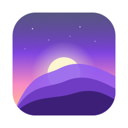

# duskpaper

**Live wallpapers for macOS. Open source, MIT licensed, and entirely local.**

duskpaper plays videos, GIFs and still images as live wallpapers behind your
desktop icons. Wallpaper Engine does this on Windows; duskpaper does it on a
Mac, without Steam, an account, or a catalogue you have to buy from. Your own
media is the library.



---

## Why this exists

Wallpaper Engine is Windows only. The macOS options tend to be subscription
apps built around a curated catalogue. duskpaper takes the same idea and keeps
it simple: point it at a video file, pick a display, and it plays. Everything
runs locally, and the app makes no network requests at all.

| | Wallpaper Engine | duskpaper |
|---|---|---|
| Platform | Windows | macOS 14 or later |
| Price | One-time purchase on Steam | Free, MIT licensed |
| Content source | Steam Workshop catalogue | Your own video, image and GIF files |
| Multi-monitor | Per-monitor wallpapers | Per-monitor wallpapers |
| Accounts and network | Steam account, online browsing | None |

duskpaper is a separate project. It is not affiliated with the Wallpaper
Engine Team, and it does not play Workshop items; it plays your files.

---

## Features

- Any media as a wallpaper: `.mp4`, `.mov`, `.m4v`, `.mkv`, `.webm`, still
  images (`.jpg`, `.png`, `.heic`, `.tiff`, `.avif`, …) and animated `.gif`.
- A different wallpaper on every display, or one wallpaper everywhere. Built
  for dual-monitor setups and works the same with three or more.
- Per-display scaling: fill, fit, stretch or centre.
- Per-display visual adjustments: contrast, brightness, saturation, warmth, hue and gamma, with quick presets (Standard, Vivid, Soft, Dimmed, Warm, Cool, Mono) and a reset — tuned independently for each display.
- Playlists: cycle through your library on a schedule, in order or shuffled.
- Still images become live. A still gets a slow, seamless Ken Burns push so it
  animates instead of sitting frozen.
- Energy aware. Playback pauses when the screen locks, the display sleeps, the
  Mac is on battery, or Low Power Mode is on.
- Menu bar control: pause, resume and next wallpaper.
- Optional launch at login, via `SMAppService`.
- A plain, native macOS interface.

---

## Install

Grab the latest `duskpaper.dmg` from
[Releases](https://github.com/Ayushman0Talukdar/duskpaper/releases), open it,
and drag duskpaper into Applications.

The download is ad-hoc signed rather than notarized, so macOS will warn the
first time you launch it. Right-click the app and choose Open, or clear the
quarantine flag from Terminal:

```bash
xattr -cr /Applications/duskpaper.app
```

After that it opens normally.

---

## Building

Requirements: macOS 14 or later (tested on macOS 26) and a Swift 6 toolchain,
which means Xcode 16 or newer. Command line tools are enough.

```bash
git clone https://github.com/Ayushman0Talukdar/duskpaper.git
cd duskpaper
./build.sh --install
```

`build.sh` compiles a release build with SwiftPM, assembles a proper
`duskpaper.app` bundle, generates the icon and code-signs it ad-hoc, then
copies it into `/Applications`.

Useful variants:

```bash
./build.sh              # build only, into ./build/duskpaper.app
./build.sh --debug      # debug build
./build.sh --install    # build and install into /Applications
```

### Regenerating the icon

```bash
swift Tools/makeicon.swift Resources
iconutil -c icns Resources/AppIcon.iconset -o Resources/AppIcon.icns
```

---

## How it works

### The wallpaper overlay

macOS draws the desktop picture, the desktop icons and every app window in
separate layers. duskpaper inserts its own borderless window *between* the
desktop picture and the desktop icons:

```
   app windows, menu bar
  ─────────────────────────
      desktop icons        ← Finder
  ─────────────────────────
   duskpaper's video window     ← one per display
  ─────────────────────────
     desktop picture       ← drawn by the Dock
```

The level for that band is **measured at runtime** rather than hardcoded.
`kCGDesktopWindowLevel` used to be the right answer, but current macOS
releases draw the desktop picture in a real window owned by the Dock, at a
level *above* `kCGDesktopWindowLevel`. An overlay at the classic level is
silently hidden behind the desktop picture and appears frozen on the first
frame. `WallpaperWindowLevel.resolve()` inspects the live window list, finds
the desktop-picture window and the icon window, and picks a level in between.

Each window contains an `AVPlayerLayer` driven by an `AVPlayerLooper`, which
loops the clip seamlessly. The window:

- is borderless, has no shadow and ignores mouse events,
- joins all Spaces and is `stationary` and `fullScreenAuxiliary`, so it
  survives Mission Control and full-screen apps,
- covers the *full* display frame, not the visible frame, so the menu bar
  strip is covered too.

### Keeping the desktop picture in sync

The first frame of the current wallpaper is extracted and set as the static
desktop picture (`NSWorkspace.setDesktopImageURL`). The desktop never flashes
the wrong image when playback starts, and pausing, for example when the screen
locks, still leaves a correct-looking desktop behind.

### Pausing

Playback is suspended when:

- the screen is locked,
- the display goes to sleep,
- Low Power Mode is enabled (optional),
- the Mac is running on battery (optional),
- the user presses pause in the menu bar.

Screen-lock detection uses the fact that the macOS **login window becomes the
frontmost application** when the Mac locks. `sessionDidResignActive` is *not*
used for this, because it also fires whenever you click another app, which
would pause the wallpaper the moment you switched windows.

### Still images

`MediaBuilder` renders a still into an H.264 movie with a slow eased zoom that
returns to its starting point, so the loop has no visible seam. GIFs are
re-encoded frame by frame, preserving their original timing. Generated
renditions are cached and invalidated when the relevant settings change.

---

## Project layout

```
Sources/duskpaper/
├── App/          AppDelegate, AppState, menu bar, login item
├── Engine/       Wallpaper engine, per-display player, media conversion,
│                 thumbnails, still frames, system monitoring
├── Model/        Wallpaper, settings, display info
├── Store/        Library and settings persistence
├── Support/      Logging and paths
└── UI/           SwiftUI views
Tools/            Icon generator, test helpers
```

### Where your data lives

| What | Where |
|---|---|
| Imported media | `~/Library/Application Support/duskpaper/Media/` |
| Library & settings | `~/Library/Application Support/duskpaper/*.json` |
| Generated renditions | `~/Library/Application Support/duskpaper/Renditions/` |
| Thumbnails, still frames, logs | `~/Library/Caches/duskpaper/` |

Nothing is uploaded, and nothing is written outside those directories.

---

## Development notes

- The app is **not sandboxed**, so it can read any file you point it at
  without a permission prompt. The code is structured so that it could be
  sandboxed later by adding security-scoped bookmarks.
- `AppSettings` and `Wallpaper` decode leniently: a missing or unexpected key
  falls back to a default instead of discarding the whole file, so settings
  survive upgrades.
- `Tools/checkplayback.swift` captures the wallpaper window's pixels twice and
  reports whether they changed. It is a quick way to confirm playback is
  actually running rather than trusting the log.

---

## License

MIT, see [LICENSE](LICENSE). duskpaper is not affiliated with Wallpaper
Engine, Wallspace, or any other commercial wallpaper app. It contains no
third-party code and no copied assets.
